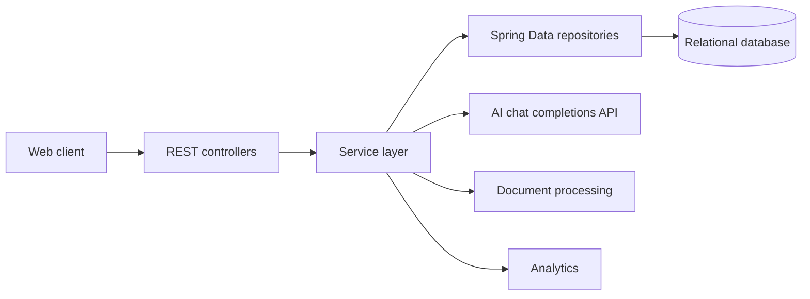

# AI Support SaaS — Backend API

A Spring Boot backend for a multi-tenant AI customer-support platform. The codebase separates HTTP controllers, services, persistence, security, and domain models.

## What the backend contains

- **Authentication:** registration/login flows and JWT-based request authentication.
- **Multi-tenant domain:** business, user, customer, chat-session, message, and lead models.
- **AI-assisted support:** chat response generation and lead-information extraction through an OpenAI-compatible Chat Completions API.
- **Conversation management:** controllers and services for chat sessions and messages.
- **Knowledge documents:** document and document-chunk models, repositories, and document endpoints.
- **Business insights:** analytics endpoints and service layer.
- **API tooling:** Springdoc OpenAPI dependency and a Postman collection in the repository.

> The default AI endpoint in `OpenAIConfig` is the Groq OpenAI-compatible endpoint, and `AIService` defaults to the `llama-3.3-70b-versatile` model. Configure the API URL, model, and API key for your own environment.

## Technology

| Area | Technologies |
|---|---|
| Language / framework | Java 17, Spring Boot 3.2.1 |
| Backend | Spring MVC, Spring Security, Spring Data JPA, Hibernate |
| Authentication | JWT (JJWT) |
| Persistence | MySQL JDBC driver; H2 is referenced in project documentation |
| Supporting services | Redis client, WebSocket |
| AI / HTTP | OpenAI-compatible chat completions API, OkHttp, Jackson |
| Documents | Apache PDFBox |
| API documentation | Springdoc OpenAPI |
| Build | Maven |

## Architecture



The source tree is organized into `controller`, `service`, `repository`, `model`, `dto`, `security`, `config`, and `exception` packages.

## Main API areas

The controller package currently includes:

- Authentication
- Business management
- Chat and conversation sessions
- Document operations
- Lead management
- Analytics

For request examples, import `postman_collection.json` into Postman and review the controller classes for the current route definitions.

## Run locally

### Prerequisites

- JDK 17
- Maven
- A configured relational database
- Redis if the enabled application configuration requires it
- An API key for the configured AI endpoint

### Configure

Review the configuration under `src/main/resources` and the sample `.env.example`. Supply environment-specific values for database connectivity, JWT signing, and the AI provider. Do not commit real API keys, passwords, or signing secrets.

**Configuration check:** the current Maven build declares the MySQL JDBC driver, while the sample `.env.example` contains a PostgreSQL JDBC URL. Align the driver and datasource URL with the database you actually run before starting the service.

### Build and test

```bash
mvn clean package
mvn test
```

### Start

```bash
mvn spring-boot:run
```

Startup depends on valid database, JWT, and AI-provider configuration in your environment.

## Repository map

```text
src/main/java/com/aisupport/api/
├── config/
├── controller/
├── dto/
├── exception/
├── model/
├── repository/
├── security/
└── service/
```

Other useful files:

- `pom.xml` — dependencies and Java/Spring Boot versions
- `postman_collection.json` — API request collection
- `docker/` — Docker-related files
- `QUICKSTART.md`, `SETUP_GUIDE.md`, `PROJECT_STRUCTURE.md` — supporting project documentation

## Security notes

- Keep secrets outside source control.
- Replace sample credentials and development secrets before deployment.
- Review authorization rules and tenant-scoped data access before exposing the API publicly.

## Current scope

This README describes the repository structure and dependencies visible in the code. It does not claim production readiness, deployment status, automated test coverage, or a completed retrieval-augmented-generation workflow.
